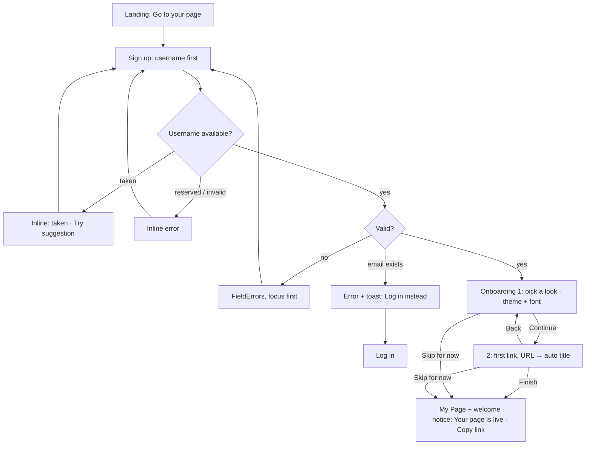
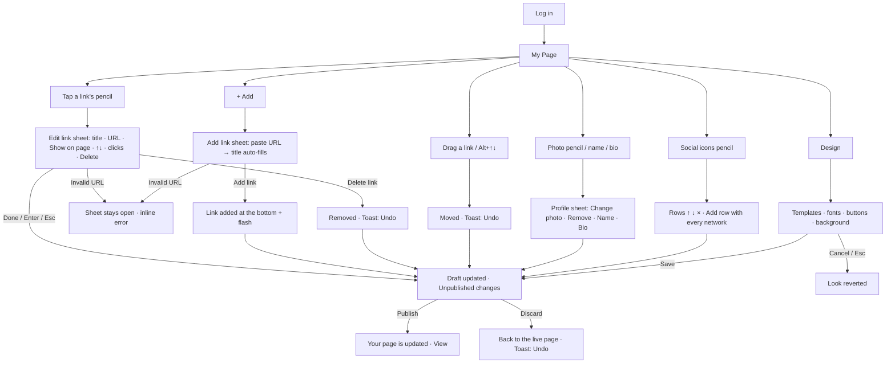
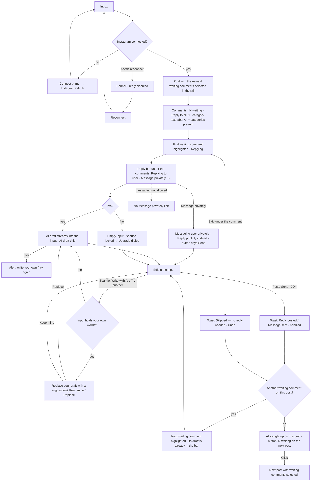
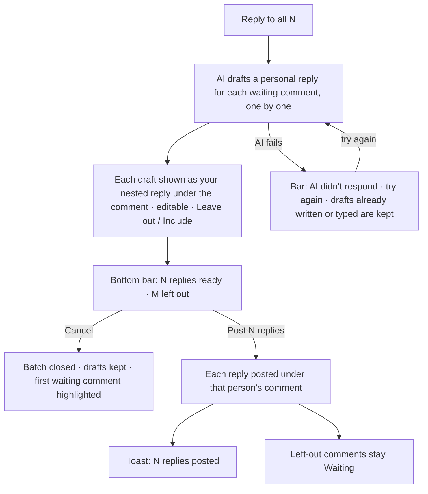
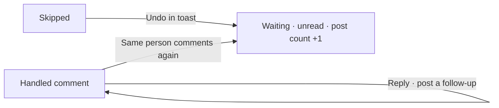
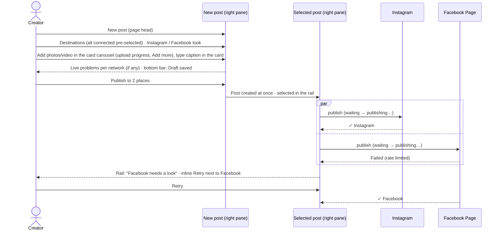
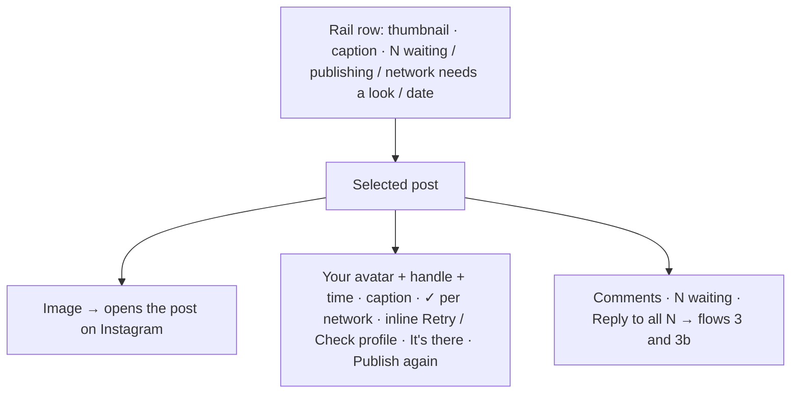
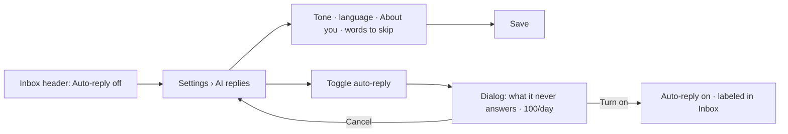
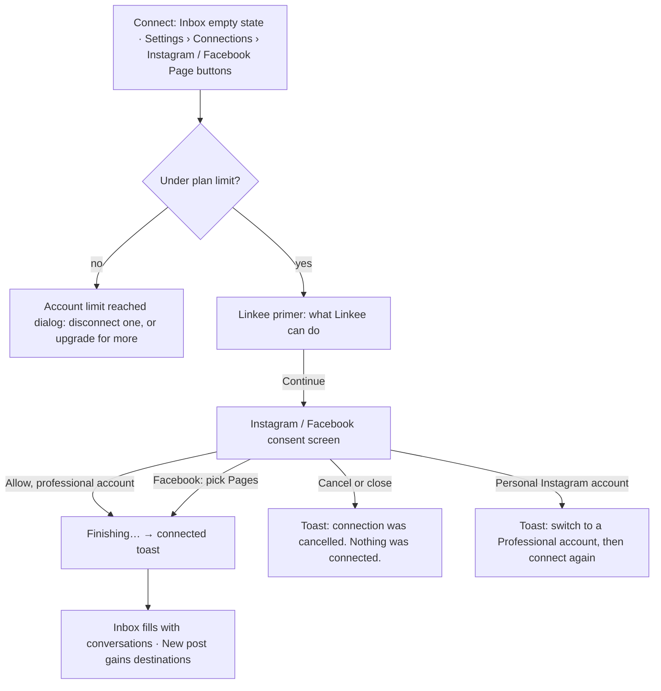
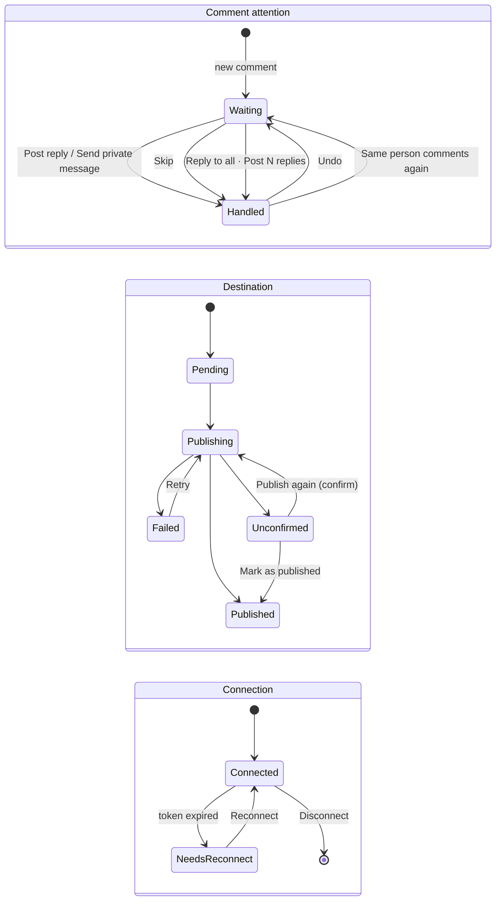

# Linkee — product flows

How the screens connect. Route names match the preview (`ux-preview.html#/…`) and map to production
routes: `#/app/page` → `/dashboard/my-page`, `#/app/inbox` → `/dashboard/inbox` (the preview's Inbox › New
post and Posts replace production's `/dashboard/publish`), `#/app/settings` → `/dashboard/settings`,
`#/<slug>` → `/<slug>`. Old `#/app/post` links redirect to Inbox › New post (`#/app/inbox?new=1`).

## Site map

```mermaid
flowchart LR
  Landing["Landing #/"] -->|Go to your page| Signup["Sign up"]
  Landing -->|Log in| Login["Log in"]
  Landing -->|Footer| Legal["Terms · Privacy · Delete your data"]
  Signup --> Welcome["Onboarding (2 steps)"]
  Welcome -->|Finish or Skip for now| Page
  Login --> Page
  subgraph Workspace
    Page["My Page"]
    Inbox["Inbox: posts rail · selected post + its comments · New post"]
    Settings["Settings"]
  end
  Page -->|View page| Public["Public page /slug"]
  Public -->|Edit page (owner)| Page
  Unclaimed["Unclaimed /slug"] -->|Claim it| Signup
```

## 1. First visit → live page



Screens: Landing → Sign up → Onboarding ×2 → My Page (welcome notice, shown once). Minimum effort:
1 click on landing, 4 fields on sign up, then Continue + Finish.

## 2. Returning creator updates the page



Every part of the page has a pencil and opens one sheet (dialog on desktop, bottom sheet on phones);
the page behind updates live. Edits stay a draft until Publish under the page.

## 3. Answer comments on a post (Quick Reply + AI draft)

The Inbox is organized around posts. Left: a rail of posts (thumbnail, caption, one line: "N waiting" /
publishing / "<network> needs a look" / date); on phones a horizontal thumbnail strip with count badges.
Right: the selected post and, under it, that post's comments only. There are no tabs: whether someone is
waiting is shown per comment and per post. A comment is one person on one post (their comments and DMs,
and your replies, nested Instagram-style).



- Comment, Instagram-style: "**username** text" with a blue dot while waiting; under it text actions:
  time · category · Reply · Skip ("Skipped" once skipped). Replies and DMs nest underneath. Waiting
  comments come first; the rest keep Instagram's order. No buttons inside comment cards.
- Tapping the category opens an inline choice (Interested · Question · Feedback · Other). If the active
  tab would hide the comment, a "Moved to X" toast offers Undo and the next waiting comment is highlighted.
- Reply (or clicking a comment) highlights it with "Replying" and points the one reply bar at it; × stops
  replying. J/K moves between comments; ⌘↵ posts. On phones the bar floats above the tab bar.
- Handled = replied (publicly or privately) or Skipped. Handled comments stay in the list without the blue
  dot; Reply on one still allows a follow-up.

## 3b. Reply to all (Pro)

**Reply to all N** is a blue text action next to the Comments title when 2+ people are waiting in the
current view (respecting the category tab). Free: it's locked and opens the upgrade dialog.



Each drafted comment uses one AI suggestion from the daily quota. On phones the bar floats above the tab
bar.

## 3c. Reopen



## 4. Post to Instagram and Facebook (Inbox › New post)

Publishing lives in the Inbox: the page head has a primary **New post** button (Free: locked, opens the
upgrade dialog). New post opens in the same right pane where the selected post usually is.



There is no results card or posts list elsewhere: the post in the rail is the record. Inline fixes next
to each network under the post:
- **Failed:** Retry.
- **Instagram didn't confirm:** Check profile, It's there (mark as published), Publish again (asks for confirmation).

### 4b. The selected post



A Facebook-only post says "This post is only on Facebook. Linkee shows Instagram comments."

## 5. Turn on auto-reply



Gate: Free → AI section shows an upsell; disconnected or broken Instagram disables the toggle.

## 5b. Connect an Instagram account or Facebook Page



Each Facebook Page becomes its own connection. Reconnect uses the same path from the warning banner.

## 6. Plan upgrade

Any locked action (Write with AI, Reply to all, New post, AI settings, Plan) opens one **Upgrade to Linkee Pro** dialog:
what Pro adds, "online checkout isn't available yet", **Contact us to upgrade** (copies the support email).
An operator then switches the account to Pro (`npm run plan:set`).

## 7. Account and page settings

| Action | Path | Guard |
|---|---|---|
| Change page address | Settings › Account › Page address → Save address | Live availability; dialog: old link stops working |
| Hide / show page | Settings › Account switch | Visitors see "This page isn't available"; owner sees a "Hidden" chip |
| Connect another account | Settings › Connections › "Instagram" or "Facebook Page" button; Inbox empty state | At the plan limit, Connect opens the "Account limit reached" dialog |
| Disconnect | "Disconnect" button on each account row | Dialog with consequences |
| Log out | Avatar menu | — |

## State transitions


