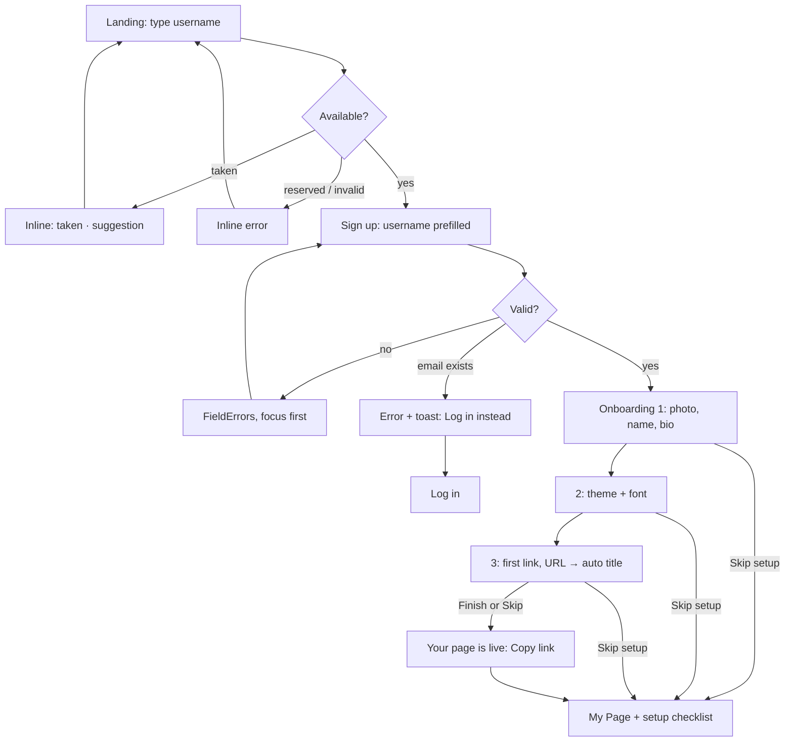
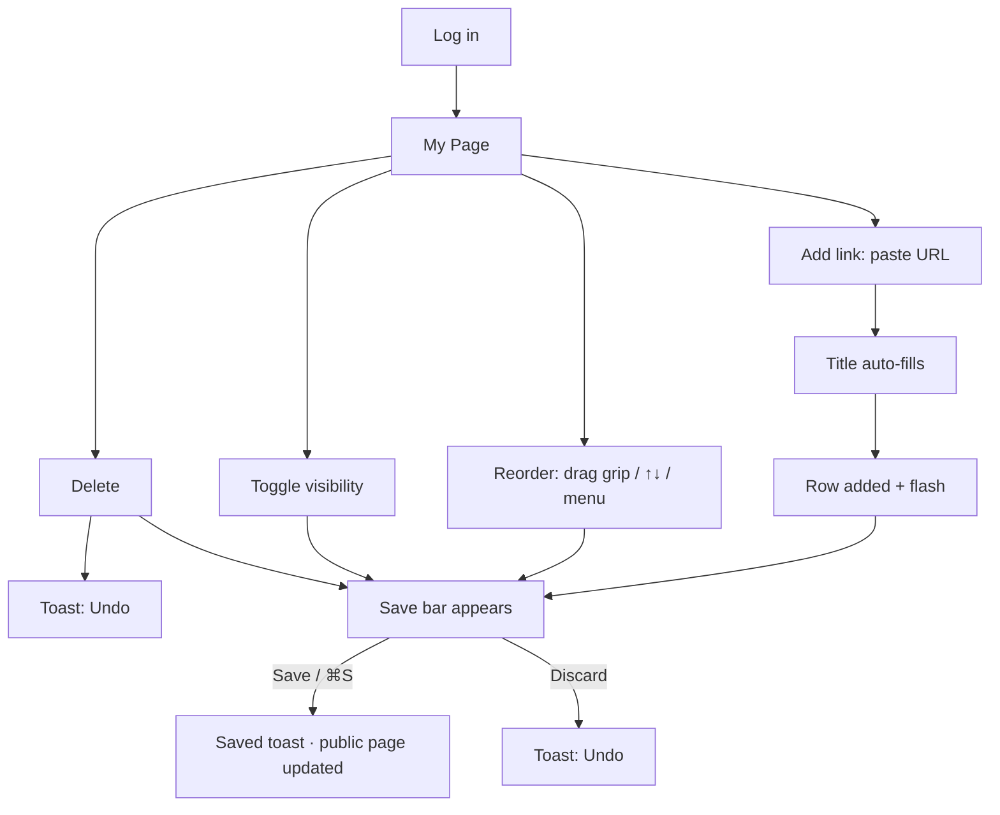
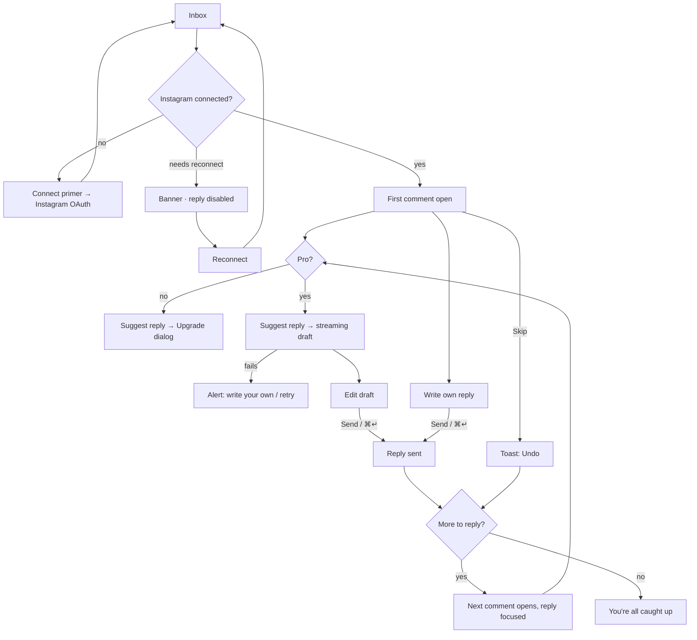
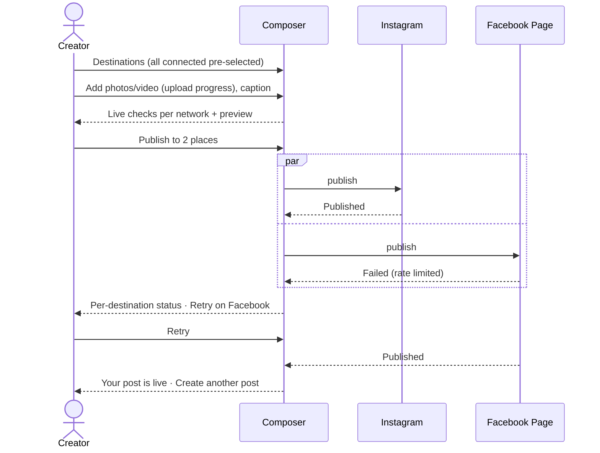
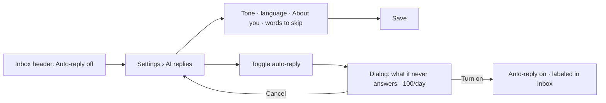
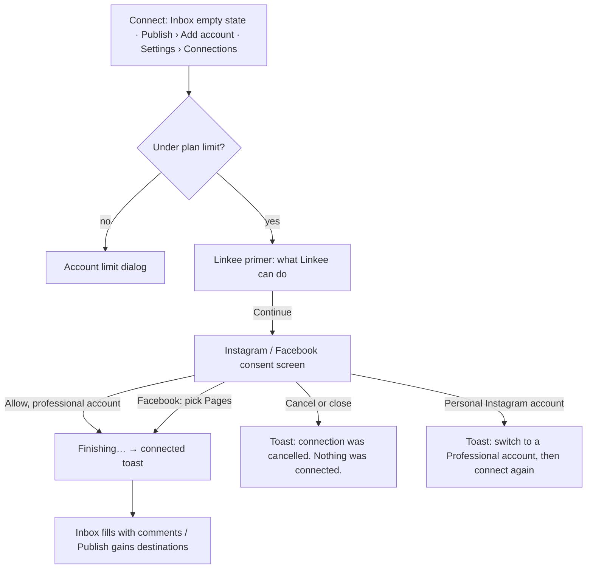
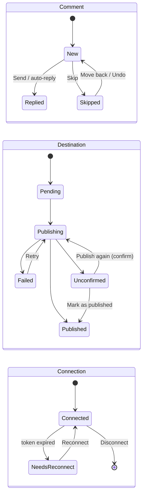

# Linkee — product flows

How the screens connect. Route names match the preview (`ux-preview.html#/…`) and map to production
routes: `#/app/page` → `/dashboard/my-page`, `#/app/inbox` → `/dashboard/inbox`,
`#/app/post` → `/dashboard/publish`, `#/app/settings` → `/dashboard/settings`, `#/<slug>` → `/<slug>`.

## Site map

```mermaid
flowchart LR
  Landing["Landing #/"] -->|Claim username| Signup["Sign up"]
  Landing --> Login["Log in"]
  Signup --> Welcome["Onboarding (3 steps)"]
  Welcome --> Live["Your page is live"]
  Live --> Page
  Login --> Page
  subgraph Workspace
    Page["My Page"]
    Inbox["Inbox"]
    Post["Publish"]
    Settings["Settings"]
  end
  Page -->|View page| Public["Public page /slug"]
  Public -->|Edit page (owner)| Page
  Unclaimed["Unclaimed /slug"] -->|Claim it| Signup
```

## 1. First visit → live page



Screens: Landing → Sign up → Onboarding ×3 → Success → My Page. Minimum effort: 1 field on landing,
3 on sign up, then Continue ×2 + Finish.

## 2. Returning creator updates the page



The preview updates live throughout; only Save publishes. Unsaved edits survive switching tabs.

## 3. Answer comments



Done tab: replied comments (labeled Written by you / AI-assisted / Auto-reply) and skipped ones (Move back to inbox).

## 4. Post to Instagram and Facebook



History rules:
- **Failed:** the row has a Retry button.
- **Unconfirmed Instagram:** a "Check first" menu with three options: Open Instagram profile, "It's there — mark as published", or "Not there — publish again" (that one asks for confirmation).

## 5. Turn on auto-reply



Gate: Free → AI section shows an upsell; disconnected or broken Instagram disables the toggle.

## 5b. Connect an Instagram account or Facebook Page



Each Facebook Page becomes its own connection. Reconnect uses the same path from the warning banner.

## 6. Plan upgrade

Any locked action (Suggest reply, Publish, AI settings, Plan) opens one **Upgrade to Linkee Pro** dialog:
what Pro adds, "online checkout isn't available yet", **Contact us to upgrade** (copies the support email).
An operator then switches the account to Pro (`npm run plan:set`).

## 7. Account and page settings

| Action | Path | Guard |
|---|---|---|
| Change page address | Settings › Account › Page address → Save address | Live availability; dialog: old link stops working |
| Hide / show page | Settings › Account switch | Visitors see "This page isn't available"; owner sees a "Hidden" chip |
| Connect another account | Settings › Connections, Publish › Add account, Inbox empty state | Plan account limit dialog |
| Disconnect | Connections row menu | Dialog with consequences |
| Log out | Avatar menu | — |

## State transitions


